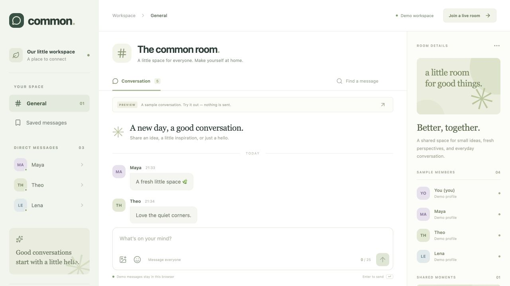

# Common

### A little space for good conversations.

A real-time client–server chat developed as a **Computer Networks course project**, with a Java / Netty server, a binary Protocol Buffers application protocol, and a React interface. Explore the built-in demo or connect multiple clients to exchange public messages, private messages, and images.

**Frontend:** React 19 · TypeScript · Vite · Lucide · CSS

**Backend:** Java 17 · Netty · WebSocket · Protocol Buffers · Maven



## Computer Networks concepts

- **Client–server architecture:** a central Netty server manages connected users and routes messages.
- **Persistent, bidirectional communication:** binary WebSocket frames carry requests and responses over a TCP connection.
- **Application protocol design:** a shared Protocol Buffers schema defines message types, payloads, protocol versions, and request identifiers.
- **Multi-client synchronization:** participant snapshots, public message sequence numbers, and bounded history batches help clients synchronize when joining.
- **Input validation:** the server checks names, text length, image formats, and payload limits.

Public and private messaging were manually verified between two browser clients connected to the Java server. See the [protocol documentation](docs/protocol.md) for the wire contract and [verification notes](docs/frontend.md) for the scope of browser checks.

## Features

- A calm, responsive workspace with an online participant list.
- Public conversation and individual private threads.
- Images, avatars, attachment previews and an image viewer.
- Search, session bookmarks, emoji and drafts per conversation.
- Visible connection/reconnect states and message errors.
- A clearly labelled demo you can explore without running the backend.

Demo data is synthetic. Live chat uses the same canonical Protobuf schema on both sides. This is a coursework-derived portfolio project, not a production messenger.

## Try the frontend

Requires Node.js 22.12+ and npm.

```sh
npm ci --prefix client --ignore-scripts
npm run dev --prefix client
```

Open **http://127.0.0.1:5173**. The preview is immediately available. Demo messages remain in this browser session; the demo does not impersonate real users or send messages to the server.

## Start both parts together

With Node, JDK 17 and Maven installed, run from the repository root:

```sh
sh scripts/dev.sh
```

This checks that ports 8080/5173 are free, builds missing server/client dependencies, and starts both processes. Open **http://127.0.0.1:5173**. Keep the terminal open; Ctrl+C stops the processes started by this script. It does not stop unrelated servers.

## Connect to live chat

Requires JDK 17 and Maven. In a second terminal, from the repository root:

```sh
mvn -f server/pom.xml clean package
mkdir -p runtime
cd runtime
java -jar ../server/target/chat-server-1.0-SNAPSHOT-jar-with-dependencies.jar
```

Choose **Join a live room** in the UI. Open another tab and use a different name to exchange messages. The Vite development server proxies `/ws` to the Java server on port 8080.

History is stored in the ignored `runtime/` directory. Stop each development process with Ctrl+C. The current Java server binds on all interfaces; its persistence and resource limits still need the improvements listed in [known issues](docs/known-issues.md).

## Build and preview

```sh
npm run build --prefix client
npm run preview --prefix client
```

Production-build preview: **http://127.0.0.1:4173**. For separate hosting, configure `VITE_WS_URL` before building or reverse-proxy `/ws`. Static hosting alone supports the demo, but live messages require the Java server. See [frontend notes](docs/frontend.md).

The combined `sh scripts/build.sh` also installs frontend dependencies, builds both parts and runs existing checks. A first installation needs access to npm and Maven Central.

To export a single-file, offline demo after building:

```sh
npm run export:preview --prefix client
```

Open `client/dist/common-preview.html` in a regular browser. The demo is self-contained. Live mode still requires the Java server and a permitted WebSocket connection.

## Under the interface

The canonical schema is [`protocol/chat.proto`](protocol/chat.proto). Protocol v2 includes version checks, request correlation, message UUIDs, participant snapshots and byte-limited history batches. A public sequence lets the client detect gaps and suppress duplicate messages while joining.

Images are limited to PNG/JPEG up to 1 MiB (avatars: 200 KiB). Names use 1–50 letters, numbers, `_` or `-`. The original 25-code-point text limit is kept and displayed in the composer.

Read the [protocol contract](docs/protocol.md) for delivery semantics and remaining limitations. Private messages are not written to shared history. A server response is not a read receipt or a guarantee of durable storage.

## Development checks

```sh
npm test --prefix client
mvn -f server/pom.xml test
sh scripts/smoke-baseline.sh
node scripts/protocol-smoke.cjs
```

The WebSocket probes require a built server and a free port 8080. They use synthetic data in temporary directories. Earlier verification reports: [baseline](docs/baseline.md), [correctness](docs/stage-1.md), [protocol](docs/stage-2.md).

## Project origins

Originally developed for the Computer Networks course and expanded into a portfolio project. React replaces the original single-file JavaScript client. Personal reports, real chat history, IDE files and build artifacts are excluded. No license has been selected yet.
